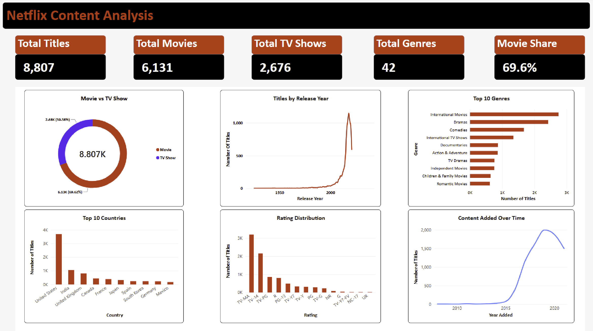

# 🎬 Netflix Content Analytics Dashboard

> An end-to-end Data Analytics project that analyzes Netflix's content catalog using **Python**, **Pandas**, and **Power BI**.  
> The project focuses on data cleaning, transformation, exploratory analysis, KPI development, and interactive dashboard visualization to uncover insights about Netflix movies and TV shows.

---

## 📊 Dashboard Preview



---

## 🎯 Project Objective

The objective of this project is to analyze Netflix's content library and answer questions such as:

- How many movies and TV shows are available?
- What is the distribution between Movies and TV Shows?
- Which genres have the most titles?
- Which countries contribute the most content?
- What are the most common content ratings?
- How has Netflix's content catalog changed over time?
- What insights can be derived from the cleaned dataset?

---

## 🛠️ Tools & Technologies

| Tool | Purpose |
|---|---|
| **Python** | Core programming language |
| **Pandas** | Data manipulation & cleaning |
| **Jupyter Notebook** | Interactive analysis environment |
| **Power BI** | Dashboard & visualization |
| **DAX** | KPI measures & calculations |
| **Git & GitHub** | Version control & collaboration |

---

## 🔄 Project Workflow

```
Raw Netflix Dataset
        ↓
 Data Exploration
        ↓
Data Cleaning & Validation
        ↓
  Data Transformation
        ↓
     CSV Export
        ↓
Power BI Data Modeling
        ↓
    DAX Measures
        ↓
 Interactive Dashboard
```

---

## 🧹 Data Cleaning

The dataset was cleaned and validated using **Pandas**.

### Main Cleaning Tasks

- Checked dataset dimensions and data types
- Identified missing values
- Checked duplicate records
- Standardized text values
- Corrected inconsistent rating values
- Converted `date_added` into a proper datetime format
- Replaced missing categorical values with `Unknown` where appropriate
- Validated `type` values to ensure only:
  - `Movie`
  - `TV Show`
- Split multi-valued genre and country fields for analysis
- Performed final validation before exporting the cleaned dataset

### Final Dataset

| Metric | Value |
|---|---|
| **Total Titles** | 8,807 |
| **Movies** | 6,131 |
| **TV Shows** | 2,676 |
| **Genres** | 42 |

---

## 📈 Power BI Dashboard

The dashboard contains **5 KPI cards** and **6 visualizations**.

### 🔢 KPI Cards

| KPI | Value |
|---|---|
| Total Titles | 8,807 |
| Total Movies | 6,131 |
| Total TV Shows | 2,676 |
| Total Genres | 42 |
| Movie Share | 69.6% |

---

### 📊 Dashboard Visualizations

#### 1. Movie vs TV Show
A **donut chart** showing the distribution between Movies and TV Shows.
- Movies: **6,131**
- TV Shows: **2,676**


---

#### 2. Titles by Release Year
A **line chart** showing the number of Netflix titles by their original release year.  
This helps identify periods where Netflix's catalog contains more recently released content.


---

#### 3. Top 10 Genres
A **horizontal bar chart** showing the most common genres/categories in the Netflix catalog.  
The multi-valued `listed_in` column was transformed into individual genre records before visualization.


---

#### 4. Top 10 Countries
A **bar chart** showing the countries associated with the highest number of Netflix titles.  
The multi-valued `country` field was split into individual country records for analysis.


---

#### 5. Rating Distribution
A **column chart** showing the distribution of Netflix titles across different content ratings.  
Examples include: `TV-MA`, `TV-14`, `TV-PG`, `R`, `PG-13`, `PG`


---

#### 6. Content Added Over Time
A **line chart** showing how many titles were added to Netflix over time.  
This helps analyze the growth and changes in Netflix's content catalog.


---

## 🧮 Key DAX Measures

### Total Titles
```dax
Total Titles = FORMAT( COUNTROWS(netflix_titles), "#,##0" )
```

### Total Movies
```dax
Total Movies = FORMAT(
    CALCULATE(
        COUNTROWS(netflix_titles),
        netflix_titles[type] = "Movie"
    ),
    "#,##0"
)
```

### Total TV Shows
```dax
Total TV Shows = FORMAT(
    CALCULATE(
        COUNTROWS(netflix_titles),
        netflix_titles[type] = "TV Show"
    ),
    "#,##0"
)
```

### Movie Share
```dax
Movie Share = FORMAT(
    DIVIDE(
        CALCULATE(
            COUNTROWS(netflix_titles),
            netflix_titles[type] = "Movie"
        ),
        COUNTROWS(netflix_titles)
    ),
    "0.0%"
)
```

---

## 📁 Project Structure

```
Netflix_Content_Analysis/
│
├── data/
│   └── netflix_cleaned.csv
│
├── Notebook/
│   └── netflix.ipynb
│
├── PowerBi/
│   └── Netflix_Content_Analytics.pbix
│
├── Screenshots/
│   ├── Dashboard.png
│   ├── Movies vs TV Shows.png
│   ├── Titles by Release Year.png
│   ├── Top 10 Genres.png
│   ├── Top 10 Countries.png
│   ├── Rating Distribution.png
│   └── Content Added Over Time.png
│
└── README.md
```

---

## 💡 Key Insights

- Netflix's catalog contains **8,807 titles**
- **Movies** make up approximately **69.6%** of the catalog
- **TV Shows** account for approximately **30.4%**
- The catalog contains **42** distinct genres/categories
- The dashboard highlights the concentration of content across genres and countries
- Rating distribution provides insight into the types of content present in Netflix's catalog
- The content-added timeline shows significant changes in Netflix's catalog activity over time

---

## 🚀 What I Learned

Through this project, I practiced:

- ✅ Data exploration using Pandas
- ✅ Handling missing values
- ✅ Data validation
- ✅ Data type conversion
- ✅ Text standardization
- ✅ Working with multi-valued columns
- ✅ Data transformation for visualization
- ✅ Power BI dashboard development
- ✅ DAX calculations
- ✅ KPI design
- ✅ Data storytelling
- ✅ Git and GitHub project management

---

## 📌 Project Highlights

> This project demonstrates an **end-to-end analytics workflow**:
>
> **Clean → Transform → Analyze → Visualize → Communicate**

It combines Python-based data preparation with Power BI visualization to turn a raw dataset into an interactive analytical dashboard.

---

## 👨‍💻 Author

**Samith Vangeti**  
🎓 Computer Science (AI & ML) Student  
📊 Aspiring Data Analyst

### Connect With Me

[](https://github.com/samith-debug)
[](https://samithvangeti.tech/)

---

> ⭐ **If you found this project useful, consider giving the repository a star!**
